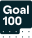

<picture>
  <source media="(prefers-color-scheme: dark)" srcset="apps/docs/public/logos/gridahead-inverse.svg">
  
</picture>

# gridAhead

An open-source and open-data community project that turns published German grid expansion plans into accessible, georeferenced datasets.

<a href="https://reiner-lemoine-institut.de/">
  <picture>
    <source media="(prefers-color-scheme: dark)" srcset="apps/docs/public/logos/reiner-lemoine-institut-inverse.svg">
    
  </picture>
</a>
&emsp;
<a href="https://goal100.org/">
  <picture>
    <source media="(prefers-color-scheme: dark)" srcset="apps/docs/public/logos/goal100-inverse.svg">
    
  </picture>
</a>

Power grids are one of the most critical bottlenecks in Germany's energy transition. Since the end of October, Germany's larger distribution system operators have been publishing a second round of their grid expansion plans, with a total of over 33,000 measures. The data are difficult to use for research, planning, investment decisions, and public policy, and often do not follow open-data standards.

Whether new wind and solar farms, battery storage, heat pumps, or charging infrastructure can be connected depends on how quickly distribution grids are reinforced. Operators serving 100,000 customers or more have to publish these plans regularly. The first round, in 2024, came as PDF only. In the second round, 80 of 85 operators deliver their measures, together over 33,000, of which about 20,000 are ongoing or planned. Where they are is still generally unclear.

The 2026 round also brought improvements: most operators now publish their measures as spreadsheets in a common format. The measures still have no coordinates, the grid maps are still only images in PDF reports, and most files are not released under open licences. Making the plans easier to use does not conflict with the protection of critical infrastructure. The project works only with information the operators have already published.

## What gridAhead is building

1. **Geocode planned measures.** Locate announced measures from both the 2024 and 2026 plans. This shows where and when the grid near a site is planned to be reinforced.
2. **Georeference grid maps.** Wherever possible, digitize the grid maps in the plans and enrich them with other public data. The aim is open data on the current and planned medium-voltage grid in Germany, so studies can use topologies based on real grid maps instead of the synthetic or model grids mostly used today.
3. **Make it accessible.** Publish results under open licences whenever possible, so others can keep working with them instead of starting from the original documents again. Data can be reused without legal uncertainty, and researchers can cite one versioned dataset instead of extracting the same PDFs again.
4. **Build a community.** An open community that uses, reviews, and further develops the data and the methods. Many users improve both faster than any single team could.

Under Sections [14d](https://www.gesetze-im-internet.de/enwg_2005/__14d.html) and [14e](https://www.gesetze-im-internet.de/enwg_2005/__14e.html) of the Energy Industry Act (EnWG), distribution system operators with 100,000 or more customers, and smaller operators with significant curtailment of wind or solar power, must publish a grid expansion plan every two years on [VNBdigital](https://www.vnbdigital.de/). The Reiner Lemoine Institute and a broad alliance called for action in a [2024 open letter](https://reiner-lemoine-institut.de/offener-brief-an-bnetza-netzdaten-besser-nutzbar-machen/) to the Bundesnetzagentur. This project is the next step.

gridAhead is a cooperation of [Goal100](https://goal100.org/) and the [Reiner Lemoine Institute](https://reiner-lemoine-institut.de/). Goal100's initiative for gridAhead is jointly funded by [Google.org](https://www.google.org/) and the [Veolia Foundation](https://www.stiftung.veolia.de/), and hosted by [ProjectTogether](https://projecttogether.org/).

## Development

Requires Node.js 24+, [pnpm](https://pnpm.io/) and [uv](https://docs.astral.sh/uv/).

```bash
pnpm install
pnpm dev     # all apps
pnpm test
pnpm lint
pnpm build
```

Apps:

- `apps/docs`: project website.
- `apps/nap_tool`: extracts and reviews tables from grid expansion plans. It needs the separate `nap_data` repository (internal GitLab); set `NAP_DATA_DIR` in `apps/nap_tool/.env`. See the [nap-tool docs](apps/docs/content/docs/nap-tool/index.mdx). For live frontend work, run `pnpm --filter nap-tool-ui dev:ui` next to `pnpm dev` and open the Vite URL.

## License

gridAhead uses [REUSE](https://reuse.software/): every file states its license, either in an SPDX header or in [`REUSE.toml`](REUSE.toml). The license texts are in [`LICENSES/`](LICENSES/).

- Code and configuration: [Apache-2.0](LICENSE)
- Website texts in `apps/docs/content/`: [CC-BY-4.0](LICENSES/CC-BY-4.0.txt)
- Citation metadata (`CITATION.cff`): [CC0-1.0](LICENSES/CC0-1.0.txt)
- The gridAhead logo and the partner and funder logos are not openly licensed. They belong to their respective owners ([`LicenseRef-AllRightsReserved`](LICENSES/LicenseRef-AllRightsReserved.txt)).

Check compliance with `uvx reuse lint`.

## Co-funded by

<a href="https://www.google.org/">
  <picture>
    <source media="(prefers-color-scheme: dark)" srcset="apps/docs/public/logos/google-org-inverse.svg">
    
  </picture>
</a>
&emsp;
<a href="https://www.stiftung.veolia.de/">
  
</a>
