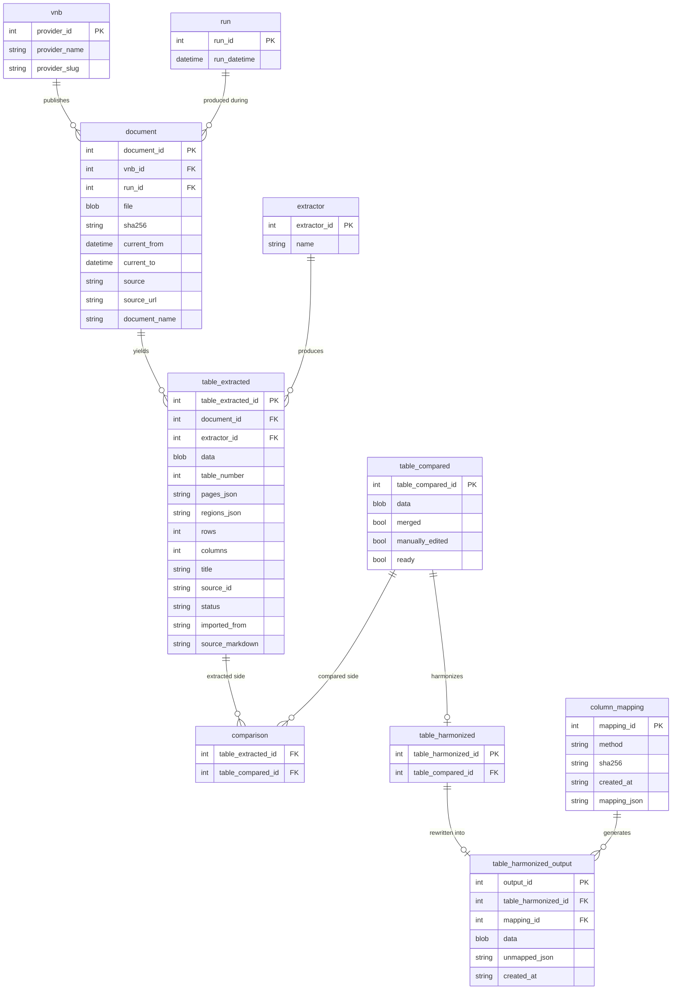

{/*
SPDX-FileCopyrightText: 2026 Chenyan Ye <https://github.com/yechenyan> © Reiner Lemoine Institut
SPDX-FileCopyrightText: 2026 Hendrik Huyskens <https://github.com/henhuy> © Reiner Lemoine Institut
SPDX-FileCopyrightText: 2026 Jonathan Amme <https://github.com/nesnoj> © Reiner Lemoine Institut

SPDX-License-Identifier: Apache-2.0
*/}

## What nap-tool does

It turns the published documents into one reviewed, harmonized and classified measures table. The source files stay as published. A cell value changes only through deterministic code. A model may propose a column mapping or a classification rule, and a person accepts that proposal before it is applied.

The commands follow that shape:

1. **Register and download.** `discover` records the documents currently on VNBdigital and does not fetch the files. `download` stores the PDFs. `sync-dso-identifiers` fills missing operator identifiers from the public Marktstammdatenregister and the BDEW registry. The 2026 spreadsheet measure lists, and the Markdown conversions of the PDF reports, were loaded by import scripts. `extract` does not read those files.
2. **Extract tables.** `extract` reads a downloaded PDF with docling, which runs locally, or with llmPDF. Each result is one extracted table and can be assigned a table type, such as a measure list. LlamaParse is an optional paid extra and is separate from those two tools.
3. **Review and clean.** `nap-tool ui` serves the review UI, starting at `/ui/overview`. A reviewer confirms an extracted table, then a cleaned copy. Cleaning types the columns, normalizes units, and drops the rows the reviewer has marked.
4. **Harmonize.** A set is the scope: one table type, a choice of operators, and a choice of NAP rounds. A scheme maps source columns onto one list of target fields and can be reused across sets. One set and one scheme produce one harmonized table.
5. **Classify.** `classify` reads a harmonized grid-measure table and adds derived columns: record type, asset type, grid level, location, and a quality grade. The source columns stay as they are. Rules live in `config/classify.yaml`, and a single-year set picks up `config/classify_<year>.yaml`. See [Classification](/docs/nap-tool/classification).

Details of the 2026 files that affect keys, asset codes, and validation are in [NAP 2026 data facts](/docs/nap-tool/nap-2026).


## Setup

```bash
uv sync
uv sync --extra docling       # local Docling extraction
uv sync --extra llamaparse    # LlamaParse adapter; not wired into `extract` yet
uv sync --extra llmpdf        # llmPDF extraction and Review UI
```

On Windows on ARM, PyTorch (needed by Docling) has no `win_arm64` wheel.
Create the environment once with x64 Python, which Windows runs emulated:

```powershell
uv python install cpython-3.12-windows-x86_64-none
uv sync --extra docling --python cpython-3.12-windows-x86_64-none
```

Later `uv sync` and `uv run` calls keep using that x64 environment. Docling
runs slower under emulation; WSL with Linux ARM wheels is the faster option.

Run commands via `uv run`. They read and write the nap_data repository set in
`NAP_DATA_DIR` (see `.env.example`):

```bash
uv run nap-tool discover      # register the NAP reports VNBdigital publishes
uv run nap-tool download      # fetch the PDFs of registered documents
uv run nap-tool extract --tool docling
uv run nap-tool extract --tool llmPDF
uv run nap-tool ui            # review tables in the browser
```

## Folder layout

```
config/providers.yaml       # VNBdigital endpoint and exceptional provider sources
config/classify*.yaml       # classification rules (see Classification)

$NAP_DATA_DIR/              # separate nap_data repository; see its README
  nap_tool.sqlite           # metadata, selections, review status; no PDF/CSV BLOBs
  pdf/<slug>/<hash>.pdf     # downloaded source PDFs, named by content hash
  documents/<slug>/         # non-PDF source documents (XLSX, Markdown)
  extracted/<slug>/<hash>/<tool>/<run>/   # table_<nnn>.csv per extraction run
  extract_reviewed/<extract>/             # reviewed extraction CSVs
  cleaned/<extract>/        # cleaned CSVs and cell metadata
  clean_reviewed/<clean>/   # reviewed cleaned CSVs
  harmonized/<set>/<scheme>.csv           # harmonized table per set and scheme
  classified/set_<set>/     # classification generations and current pointers
  scripts/extract/, scripts/clean/        # snapshots of extraction and cleaning code

src/nap_tool/
  cli.py                    # typer app; registers one subcommand per module
  config.py                 # loads and validates config/providers.yaml
  data.py                   # paths and content-addressed writes in nap_data
  downloader/               # `discover`, `download`, `sync-dso-identifiers`
  extractor/
    commands.py             # `extract` subcommand (docling or llmPDF)
    models.py               # shared extraction metadata contract
    tools/
      docling_tool.py       # local, free; struggles with image-only tables
      llmpdf_tool.py        # adapter for the published llmPDF package
      llamaparse_tool.py    # adapter for the paid LlamaParse tier; not wired into `extract`
  cleaning.py, harmonize.py # cleaning and harmonization logic used by the UI
  classifier/               # `classify` subcommand and rules
  database/                 # schema, repository, `upgrade`, `migrate`
  ui/                       # `ui` subcommand: FastAPI server and review frontend
```

`discover` asks VNBdigital for each DSO's grid expansion documents and
registers the newest NAP report per DSO in `nap_tool.sqlite`, without
downloading it. It reports how many documents it found and how many are new; a
registered document counts as known from then on, even before its PDF is
downloaded. `download` fetches the PDFs of registered documents that have none
yet and stores each as `pdf/<slug>/<hash>.pdf`. Stored files are never
overwritten, and the `document` table keeps every version. Extraction output
stays unchanged by review; reviews and cleaning write new files next to it.

## Table type settings

Open `/ui/settings` to create or delete table types. Types in use by extracted
tables or harmonization schemes cannot be deleted. The table type selectors
read this registry; each extracted table can have one type or none.
Table type assignments live in `extract_table_type`, keyed by extracted table.

## Harmonization sets

Manage sets in `/ui/settings`: choose a name, table type, DSOs and NAP rounds.
Empty DSO/NAP round selections include all. Counts are recalculated from selected documents and their selected,
non-archived tables with a selected cleaning version; year-specific sets exclude
undated documents. Schemes store reusable field mappings without a table type.
CSV generation uses the selected Set’s table type, DSOs and NAP rounds.

## Database schema



`comparison` is the m:n join between `table_extracted` and `table_compared`.
`table_harmonized` only marks the reviewed tables selected for harmonization
(the measure tables); the mark itself carries no harmonized fields.

`run` is one `download` invocation; `document` keeps full history — a new row
per download, never overwritten. `table_extracted` and `table_compared` stay
overwrite-in-place (upsert on document/extractor and on comparator output),
no history kept for those two. `current_from`/`current_to` was VNBdigital's
own validity window; VNBdigital no longer provides one, so `discover` now
stores the publication date (or the upload date when that is missing) as the
version and leaves `current_to` empty. `pages_json`/`regions_json`
hold per-page numbers and bounding boxes as JSON text rather than child
tables. Failed extraction attempts are not persisted — only successful
`table_extracted` rows exist in the DB.

## Harmonization

The database UI's field statistics group the measure tables' column names in
four ways: original names, LCS ≥80%, LCS ≥60% and the saved AI field plan.
Those views are proposals. Applying one turns it into a `column_mapping` — the
explicit decision about which original column names become which target field —
and rewrites every marked measure table into `table_harmonized_output` with
that mapping's columns, in its order, missing fields left empty.

Deriving and applying are deterministic and make no model calls, so re-applying
the same view rebuilds the same mapping and reuses its row. Column names no
mapping covers are recorded per table in `unmapped_json` rather than dropped
silently, and the mapping itself is downloadable as a CSV next to the tables it
produced. Only one mapping is in force: applying replaces the whole harmonized
output layer.

## Extract tables

`extract` accepts two tools, `docling` (the default, runs locally) and `llmPDF`:

```bash
uv run nap-tool extract --tool docling
uv run nap-tool extract --tool docling --dso avacon-netz-gmbh
uv run nap-tool extract --tool llmPDF --dso avacon-netz-gmbh --pages 1,3-5
```

`--dso` limits a run to one operator and `--document` to one document (exact
title or ID). Documents that already have an extraction by the selected tool are
skipped unless `--force` creates a new version. `--pages` selects pages for llmPDF
only. llmPDF is installed from PyPI and is never vendored or modified in this
repository.

The source PDF is read from `pdf/<slug>/` after its SHA-256 is checked against
the database; it is never modified. Each run is stored as
`extracted/<slug>/<hash>/<tool>/<run>/table_<nnn>.csv`, and llmPDF's native
result is kept beside the tables in `native/`. A snapshot of the tool version and
adapter code goes to `scripts/extract/<tool>/`.

The LlamaParse adapter (`extractor/tools/llamaparse_tool.py`, extra `llamaparse`)
is not wired into `extract` at the moment.

## Review tables

```bash
uv run nap-tool ui
```

The command checks the data version (see [Data version](#data-version)), then
serves the UI at `http://127.0.0.1:8000/ui/overview` (`--host` and `--port`
change the address). A reviewer confirms an extracted table, which is written to
`extract_reviewed/<extract>/`, then cleans it: cleaned copies and their cell
metadata go to `cleaned/<extract>/`, the reviewed cleaned table to
`clean_reviewed/<clean>/`. The automatic CSVs under `extracted/` remain
unchanged.

## Add a DSO source

VNBdigital is enabled by default and discovers all DSOs automatically.
Only add an entry to `config/providers.yaml` when a DSO is not available
there or needs a special direct URL:

```yaml
providers:
  - name: "New Grid Co"
    slug: "new-grid-co"          # used in nap_data paths, e.g. pdf/<slug>/
    source_type: hub              # hub | custom | manual
    hub_match: "New Grid Co"      # link text on the hub page (source_type: hub only)
    # url: "https://..."          # direct download URL (source_type: custom only)
    # note: "..."                 # free-text, e.g. why this is manual
```

Downloaded PDFs are stored as `pdf/<slug>/<hash>.pdf`; the original document
name stays in `document.title`.

To update just one VNBdigital DSO, use its generated slug:

```bash
uv run nap-tool discover --dso westnetz-gmbh
uv run nap-tool download --dso westnetz-gmbh
```

## Add a source type

Source-type dispatch lives in `src/nap_tool/downloader/sources.py`, in
`download_provider`. Implement one of `_download_from_hub` or
`_download_from_url` (or add a new source type: extend `SourceType` in
`config.py`, add a branch in `download_provider`, add a `_download_from_*`
function). Each fetch function is responsible for saving files into the
`provider_dir` it's given.

For a brand new source type unrelated to hub/custom/manual, you probably
don't need a new file — add the function to `sources.py` and wire it into
`download_provider`'s dispatch.

## Add an extraction tool

1. Add `src/nap_tool/extractor/tools/<name>_tool.py` with an
   `extract(...) -> ExtractionMetadata` function matching `docling_tool.py` and
   writing one CSV per table, named with `models.table_filename`.
2. Add one dispatch branch in `src/nap_tool/extractor/commands.py`. Extractors
   never approve their own output; approval belongs to the review workflow.
3. Add any new dependency to `pyproject.toml` — consider an optional extra
   (e.g. `nap-tool[docling]`) if it's heavy or has a system dependency, so it
   isn't forced on everyone running `uv sync`.

## Add a new module (beyond download/extract)

1. New subpackage under `src/nap_tool/<module>/`.
2. A command function, e.g. `src/nap_tool/<module>/commands.py:my_command`.
3. Register it in `src/nap_tool/cli.py`:
   ```python
   from nap_tool.<module>.commands import my_command
   app.command(name="my-command")(my_command)
   ```

No plugin system or auto-discovery — modules are wired in by hand, on
purpose, since there are only ever a handful of them.

## Classify grid measures

After generating and activating a grid-measure harmonization scheme, run
`uv run nap-tool classify` or click **Run classification** on the harmonized
results page. Classification adds semantic fields without changing source data,
and saves quality reports and unmapped values alongside the classified CSV.
See [classification usage and configuration](/docs/nap-tool/classification).

Harmonization schemes are created by copying an existing scheme, starting blank,
or grouping column headers with LCS at 80% or 60%. LCS creation saves an editable
mapping; there are no default system schemes. A scheme has an optional initial Set
that supplies the default selection on the results page; the editor still uses all
tables of its type. Select a Set and a same-type scheme to generate, preview, or
download a result. Each combination is stored in `harmonize_set_output` and at
`harmonized/<set_slug>/<scheme_slug>.csv`. Membership and source changes make the
affected results stale. Results always require a Set, using the initial Set when
no explicit selection is supplied. Scheme names are unique by slug and cannot be
changed after creation. Output metadata lives only in `harmonize_set_output`.
Classification uses the selected Set and scheme; no global activation is needed.
Document cards offer Edit year to update `document.nap_year` or mark it unknown.
Year changes update Set membership and invalidate affected outputs.

Document years are stored in `document.nap_year` (nullable, 2000–2100).
Import and upgrade infer the initial year once; overview editing and Set filters
read and write this column directly. `version` holds the plain source start date,
and `current_to` preserves the source expiry date, replacing legacy version JSON.
Each Set has a nullable `current_scheme_id`. The result page
uses it by default and can save the selected scheme as the Set default. A scheme
used as a Set default cannot be deleted until that default is changed or cleared.

Table type belongs to the Set (and to the individual extraction classifications),
not to the scheme, so schemes can be reused across Sets. The initial Set is only a
default selection. Classification requires the selected Set to contain grid-measure
tables. Changing a Set’s filters invalidates its generated outputs.

## Data version

`nap_tool.sqlite` carries the nap_data format version in `PRAGMA user_version`;
this nap_tool expects `DB_VERSION = 21` (`src/nap_tool/database/schema.py`). Every
database open refuses another version and says whether to update nap_tool or
nap_data, and `nap-tool ui` prints the version on startup. `connect()` creates the
schema in an empty file and never upgrades. If nap_data is older than this
nap_tool, `uv run nap-tool upgrade` applies the steps in
`src/nap_tool/database/upgrade.py` (the first starts at DB_VERSION 20); then commit
and push nap_data so others pick up the new version.

Bump `DB_VERSION` when a nap_tool built for the old value would fail on or misread
data written under the new one, or the reverse: SQL schema, seeded ids such as
`TABLE_TYPE_GRID_MEASURES`, stored path layout, or file formats the code parses.
New documents, tables, reviews and outputs never bump it. An upgrade sets the new
`user_version` in the same transaction as its changes. Git cannot diff the binary
database, so title the nap_data commit `DB_VERSION <old> -> <new>: <reason>`.
`tests/test_db_version.py` fails whenever `SCHEMA` changes, so every schema edit
needs a deliberate version decision.
