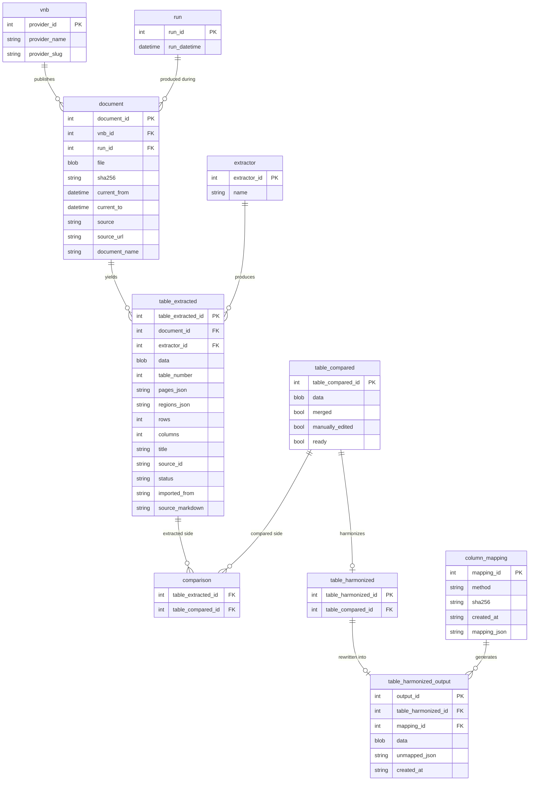

<!--
SPDX-FileCopyrightText: 2026 Chenyan Ye <https://github.com/yechenyan> © Reiner Lemoine Institut
SPDX-FileCopyrightText: 2026 Hendrik Huyskens <https://github.com/henhuy> © Reiner Lemoine Institut
SPDX-FileCopyrightText: 2026 Jonathan Amme <https://github.com/nesnoj> © Reiner Lemoine Institut

SPDX-License-Identifier: Apache-2.0
-->

# nap-tool

Downloads grid extension plan documents, extracts their tables with multiple
tools, and lets reviewers accept normalized CSV output.

## Setup

```bash
uv sync
uv sync --extra docling       # local Docling extraction
uv sync --extra llamaparse    # optional LlamaParse Agentic extraction
uv sync --extra llmpdf        # llmPDF extraction and Review UI
```

On Windows on ARM, PyTorch (needed by Docling) has no `win_arm64` wheel.
Create the environment once with x64 Python, which Windows runs emulated:

```powershell
uv python install cpython-3.12-windows-x86_64-none
uv sync --extra docling --python cpython-3.12-windows-x86_64-none
```

Later `uv sync` and `uv run` calls keep using that x64 environment. Docling
runs slower under emulation; WSL with Linux ARM wheels is the faster option.

Run commands via `uv run`:

```bash
uv run nap-tool download
uv run nap-tool extract --tool docling
uv run nap-tool extract --tool llmPDF
uv run nap-tool compare
```

## Folder layout

```
config/providers.yaml       # VNBdigital endpoint and exceptional provider sources

data/                       # gitignored; not committed
  raw/<slug>/
    metadata.json           # source URL, document ID, timestamp, SHA-256
    nap.pdf                 # newest VNBdigital NAP (stable filename)
    <original_filename>.csv
  processed/
    extracted/<slug>/
      docling/
        nap_table_<n>.csv   # Docling's raw table output
        metadata.json       # source page, table number, regions, dimensions
      llamaparse/
        nap_table_<n>.csv   # optional LlamaParse Agentic output
        metadata.json
      llmPDF/
        nap_table_<n>.csv   # normalized llmPDF table output
        metadata.json
        result/nap/         # native llmPDF output used by the Review UI
    compared/<slug>/
      nap_table_<n>.csv     # table accepted in the comparator
      metadata.json         # selected tool, merge and manual-edit provenance

src/nap_tool/
  cli.py                    # typer app; registers one subcommand per module
  config.py                 # loads and validates config/providers.yaml
  downloader/
    commands.py             # `download` subcommand
    sources.py               # per-source-type fetch logic (hub / custom / manual)
  extractor/
    commands.py             # `extract` subcommand
    models.py               # shared CSV metadata contract
    tools/
      docling_tool.py        # local, free; struggles with image-only tables
      llamaparse_tool.py      # cloud Agentic tier; optional and paid
      llmpdf_tool.py          # adapter for the published llmPDF package
  docling_importer/          # imports existing Docling output
  comparator/                # bridge to the packaged llmPDF Review UI
```

`download` discovers every currently published VNBdigital NAP and writes its
newest document as `data/raw/<provider>/nap.pdf`, overwriting the prior
download — there's no version history. `metadata.json` records the source,
document ID, timestamp, byte count, and SHA-256. Extraction output remains
tool-specific and unchanged by review. Only tables approved in llmPDF Review
are written to `processed/compared`.

## Table type settings

Open `/ui/settings` to create or delete table types. Types in use by extracted
tables or harmonization schemes cannot be deleted. The table type selectors
read this registry; each extracted table can have one type or none.
Table type assignments live in `extract_table_type`, keyed by extracted table.

## Harmonization sets

Manage sets in `/ui/settings`: choose a name, table type, DSOs and NAP rounds.
Empty DSO/NAP round selections include all. Counts are recalculated from selected documents and their selected,
non-archived tables with a selected cleaning version; year-specific sets exclude
undated documents. Schemes store reusable field mappings without a table type.
CSV generation uses the selected Set’s table type, DSOs and NAP rounds.

## Database schema



`comparison` is the m:n join between `table_extracted` and `table_compared`.
`table_harmonized` only marks the reviewed tables selected for harmonization
(the measure tables); the mark itself carries no harmonized fields.

`run` is one `download` invocation; `document` keeps full history — a new row
per download, never overwritten. `table_extracted` and `table_compared` stay
overwrite-in-place (upsert on document/extractor and on comparator output),
no history kept for those two. `current_from`/`current_to` was VNBdigital's
own validity window; VNBdigital no longer provides one, so `discover` now
stores the publication date (or the upload date when that is missing) as the
version and leaves `current_to` empty. `pages_json`/`regions_json`
hold per-page numbers and bounding boxes as JSON text rather than child
tables. Failed extraction attempts are not persisted — only successful
`table_extracted` rows exist in the DB.

## Harmonization

The database UI's field statistics group the measure tables' column names in
four ways: original names, LCS ≥80%, LCS ≥60% and the saved AI field plan.
Those views are proposals. Applying one turns it into a `column_mapping` — the
explicit decision about which original column names become which target field —
and rewrites every marked measure table into `table_harmonized_output` with
that mapping's columns, in its order, missing fields left empty.

Deriving and applying are deterministic and make no model calls, so re-applying
the same view rebuilds the same mapping and reuses its row. Column names no
mapping covers are recorded per table in `unmapped_json` rather than dropped
silently, and the mapping itself is downloadable as a CSV next to the tables it
produced. Only one mapping is in force: applying replaces the whole harmonized
output layer.

## Extract tables

Docling is the default local extractor:

```bash
uv run nap-tool extract --tool docling
uv run nap-tool extract --tool docling --dso avacon-netz-gmbh
```

LlamaParse uses the paid Agentic tier and is never called unless selected
explicitly. `LLAMA_CLOUD_API_KEY` must be present in the environment. Limit a
run to specific one-based pages when possible:

```bash
uv run nap-tool extract --tool llamaparse --dso mainzer-netze-gmbh --pages 13
```

llmPDF is installed from PyPI and is never vendored or modified in this
repository. Its output is normalized to the same `nap_table_<n>.csv` contract:

```bash
uv run nap-tool extract --tool llmPDF
uv run nap-tool extract --tool llmPDF --dso avacon-netz-gmbh --pages 1,3-5
```

The source PDF remains at `data/raw/<slug>/nap.pdf` and is read without being
copied or modified. The native llmPDF result is retained below
`data/processed/extracted/<slug>/llmPDF/result/nap/` for review and resumable
processing.

## Compare and accept tables

```bash
uv run nap-tool compare
```

The command launches the documented `llmpdf review` CLI shipped by llmPDF. It displays `nap.pdf`
beside the generated Markdown and compares llmPDF tables with their retained
Docling source tables. Reviewers can approve, ignore, annotate, and edit tables.
Publishing writes approved tables to `data/processed/compared/<slug>/` using
the existing `nap_table_<n>.csv` and comparison metadata contract. The
normalized extraction CSVs under `processed/extracted` remain unchanged. The
comparison metadata also records whether the final llmPDF source was `ai`,
`docling`, or `custom`.

## Add a DSO source

VNBdigital is enabled by default and discovers all DSOs automatically.
Only add an entry to `config/providers.yaml` when a DSO is not available
there or needs a special direct URL:

```yaml
providers:
  - name: "New Grid Co"
    slug: "new-grid-co"          # used as the folder name under data/
    source_type: hub              # hub | custom | manual
    hub_match: "New Grid Co"      # link text on the hub page (source_type: hub only)
    # url: "https://..."          # direct download URL (source_type: custom only)
    # note: "..."                 # free-text, e.g. why this is manual
```

Downloaded VNBdigital PDFs use the stable path `data/raw/<slug>/nap.pdf`.
Original document names remain available in downloader and extraction metadata.

To update just one VNBdigital DSO, use its generated slug:

```bash
uv run nap-tool download --dso westnetz-gmbh
```

## Add a source type

Source-type dispatch lives in `src/nap_tool/downloader/sources.py`, in
`download_provider`. Implement one of `_download_from_hub` or
`_download_from_url` (or add a new source type: extend `SourceType` in
`config.py`, add a branch in `download_provider`, add a `_download_from_*`
function). Each fetch function is responsible for saving files into the
`provider_dir` it's given.

For a brand new source type unrelated to hub/custom/manual, you probably
don't need a new file — add the function to `sources.py` and wire it into
`download_provider`'s dispatch.

## Add an extraction tool

1. Add `src/nap_tool/extractor/tools/<name>_tool.py` with an
   `extract(...) -> ExtractionMetadata` function matching `docling_tool.py` and
   writing `nap_table_<n>.csv` files.
2. Add one dispatch branch in `src/nap_tool/extractor/commands.py`. Extractors
   never approve their own output; approval belongs to the review workflow.
3. Add any new dependency to `pyproject.toml` — consider an optional extra
   (e.g. `nap-tool[docling]`) if it's heavy or has a system dependency, so it
   isn't forced on everyone running `uv sync`.

## Add a new module (beyond download/extract)

1. New subpackage under `src/nap_tool/<module>/`.
2. A command function, e.g. `src/nap_tool/<module>/commands.py:my_command`.
3. Register it in `src/nap_tool/cli.py`:
   ```python
   from nap_tool.<module>.commands import my_command
   app.command(name="my-command")(my_command)
   ```

No plugin system or auto-discovery — modules are wired in by hand, on
purpose, since there are only ever a handful of them.

## Classify grid measures

After generating and activating a grid-measure harmonization scheme, run
`uv run nap-tool classify` or click **Run classification** on the harmonized
results page. Classification adds semantic fields without changing source data,
and saves quality reports and unmapped values alongside the classified CSV.
See [classification usage and configuration](docs/classification.md).

Harmonization schemes are created by copying an existing scheme, starting blank,
or grouping column headers with LCS at 80% or 60%. LCS creation saves an editable
mapping; there are no default system schemes. A scheme has an optional initial Set
that supplies the default selection on the results page; the editor still uses all
tables of its type. Select a Set and a same-type scheme to generate, preview, or
download a result. Each combination is stored in `harmonize_set_output` and at
`harmonized/<set_slug>/<scheme_slug>.csv`. Membership and source changes make the
affected results stale. Results always require a Set, using the initial Set when
no explicit selection is supplied. Scheme names are unique by slug and cannot be
changed after creation. Output metadata lives only in `harmonize_set_output`.
Classification uses the selected Set and scheme; no global activation is needed.
Document cards offer Edit year to update `document.nap_year` or mark it unknown.
Year changes update Set membership and invalidate affected outputs.

Document years are stored in `document.nap_year` (nullable, 2000–2100).
Import and upgrade infer the initial year once; overview editing and Set filters
read and write this column directly. `version` holds the plain source start date,
and `current_to` preserves the source expiry date, replacing legacy version JSON.
Each Set has a nullable `current_scheme_id`. The result page
uses it by default and can save the selected scheme as the Set default. A scheme
used as a Set default cannot be deleted until that default is changed or cleared.

Table type belongs to the Set (and to the individual extraction classifications),
not to the scheme, so schemes can be reused across Sets. The initial Set is only a
default selection. Classification requires the selected Set to contain grid-measure
tables. Changing a Set’s filters invalidates its generated outputs.

## Data version

`nap_tool.sqlite` carries the nap_data format version in `PRAGMA user_version`;
this nap_tool expects `DB_VERSION = 20` (`src/nap_tool/database/schema.py`). Every
database open refuses another version and says whether to update nap_tool or
nap_data, and `nap-tool ui` prints the version on startup. `connect()` creates the
schema in an empty file and never upgrades; there is no upgrade path from earlier
versions.

Bump `DB_VERSION` when a nap_tool built for the old value would fail on or misread
data written under the new one, or the reverse: SQL schema, seeded ids such as
`TABLE_TYPE_GRID_MEASURES`, stored path layout, or file formats the code parses.
New documents, tables, reviews and outputs never bump it. An upgrade sets the new
`user_version` in the same transaction as its changes. Git cannot diff the binary
database, so title the nap_data commit `DB_VERSION <old> -> <new>: <reason>`.
`tests/test_db_version.py` fails whenever `SCHEMA` changes, so every schema edit
needs a deliberate version decision.
